# Examples

Every file in [`examples/`](examples/), with the picture it draws. Run one with:

```bash
cargo run --release -- examples/dense-toy.spiro
```

The pictures are made with `--svg` (see the [README](README.md#running-it)), so they show
the finished curves without the ring, wheels and arms.

## Contents

- [`dense-toy.spiro`](#dense-toy): 52-tooth wheel in a 105-tooth ring: 105 loops
- [`fractal-7-fold.spiro`](#fractal-7-fold): Fractal, speed multiplier −6
- [`farris-18-fold.spiro`](#farris-18-fold): Mandala from speeds 1, 19, −35
- [`mandala-24-fold.spiro`](#mandala-24-fold): Mandala from speeds 7, −17, 31
- [`coding-train.spiro`](#coding-train): The Coding Train's fractal spirograph
- [`fractal-8-fold.spiro`](#fractal-8-fold): Fractal, speed multiplier −7
- [`fractal-same-direction.spiro`](#fractal-same-direction): Fractal with every arm spinning the same way
- [`string-art.spiro`](#string-art): 35-tooth wheel in a 96-tooth ring: 96 loops
- [`fractal-4-fold.spiro`](#fractal-4-fold): Fractal, speed multiplier −3
- [`fractal-6-fold.spiro`](#fractal-6-fold): Fractal, speed multiplier −5
- [`farris-6-fold.spiro`](#farris-6-fold): Farris's wheels on wheels: speeds 1, 7, −17
- [`farris-5-fold.spiro`](#farris-5-fold): Farris-style: speeds 1, 6, −14
- [`rosette.spiro`](#rosette): Three toy wheels in one ring
- [`cusps.spiro`](#cusps): Deltoid, astroid and ellipse
- [`epicycloids.spiro`](#epicycloids): Cardioid and nephroid
- [`star.spiro`](#star): Five-pointed star from two arms
- [`toy.spiro`](#toy): Two toy wheels in a 96-tooth ring
- [`fractal.spiro`](#fractal): The README's fractal
- [`readme.spiro`](#readme): The README example: classic, toy and fractal

## dense-toy

52-tooth wheel in a 105-tooth ring: 105 loops.

<table>
<tr>
<td width="320" valign="top">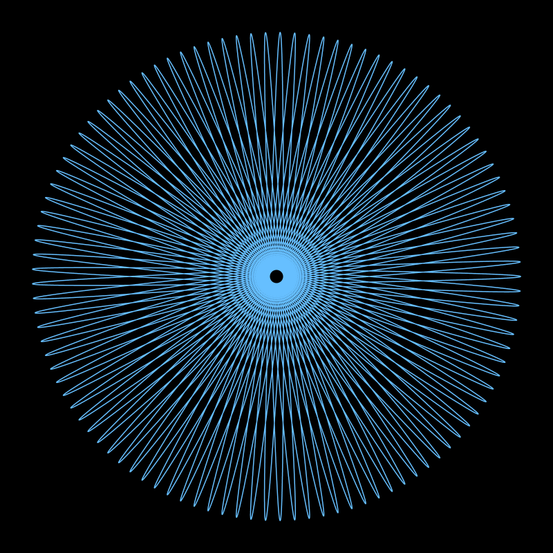</td>
<td valign="top">

```
# A 52-tooth wheel in a 105-tooth ring. 52 and 105 share no factor, so the
# wheel goes round 52 times before the pen gets back to the start, drawing
# 105 loops. With the pen near the wheel's rim, the loops sweep in almost
# to the centre and fill the whole circle.
background black

layer {
  pen skyblue 1.5
  toy ring 105 wheel 52 hole 50
}
```

</td>
</tr>
</table>

[`examples/dense-toy.spiro`](examples/dense-toy.spiro) · [back to contents](#contents)

## fractal-7-fold

Fractal, speed multiplier −6.

<table>
<tr>
<td width="320" valign="top">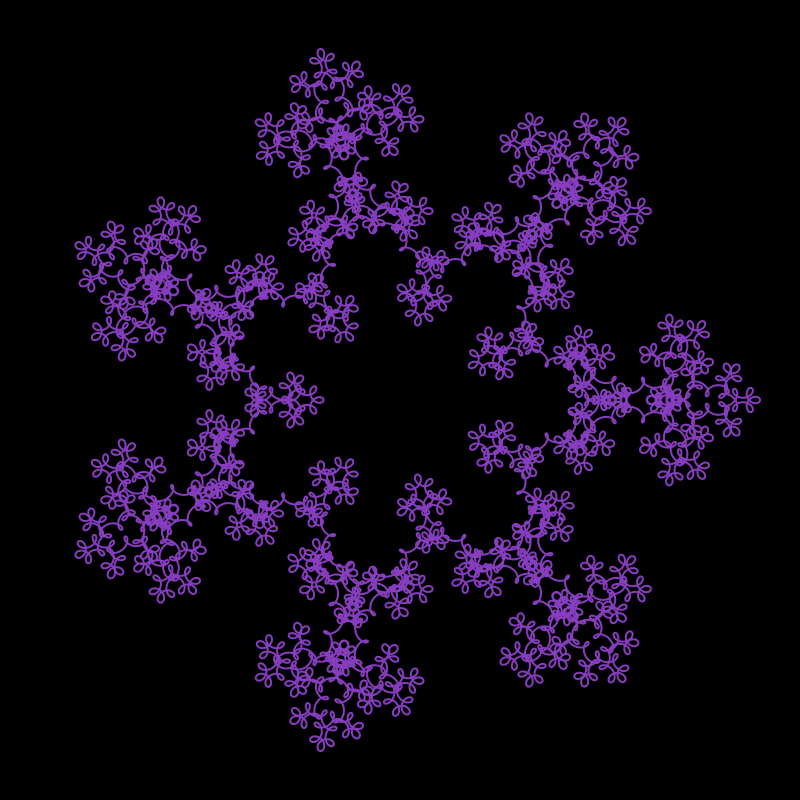</td>
<td valign="top">

```
# A fractal with a speed multiplier of -6, so 7-fold symmetry. The arms only
# shrink to 2/5 each time, so the fast small arms still add visible detail.
background black

layer {
  pen violet 2
  fractal {
    length 60
    speed 1
    length_multiplier 2/5
    speed_multiplier -6
    count 5
  }
}
```

</td>
</tr>
</table>

[`examples/fractal-7-fold.spiro`](examples/fractal-7-fold.spiro) · [back to contents](#contents)

## farris-18-fold

Mandala from speeds 1, 19, −35.

<table>
<tr>
<td width="320" valign="top">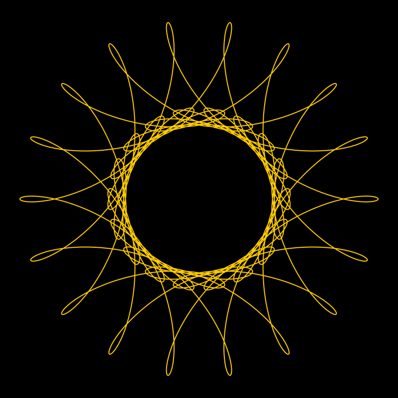</td>
<td valign="top">

```
# A Farris-style mandala: the speeds 1, 19 and -35 are all 1 more than a
# multiple of 18, so the curve has 18-fold symmetry.
background black

layer {
  pen gold 2
  classic {
    ring 80
    arm 60 speed 1
    arm 35 speed 19
    arm 25 speed -35
  }
}
```

</td>
</tr>
</table>

[`examples/farris-18-fold.spiro`](examples/farris-18-fold.spiro) · [back to contents](#contents)

## mandala-24-fold

Mandala from speeds 7, −17, 31.

<table>
<tr>
<td width="320" valign="top">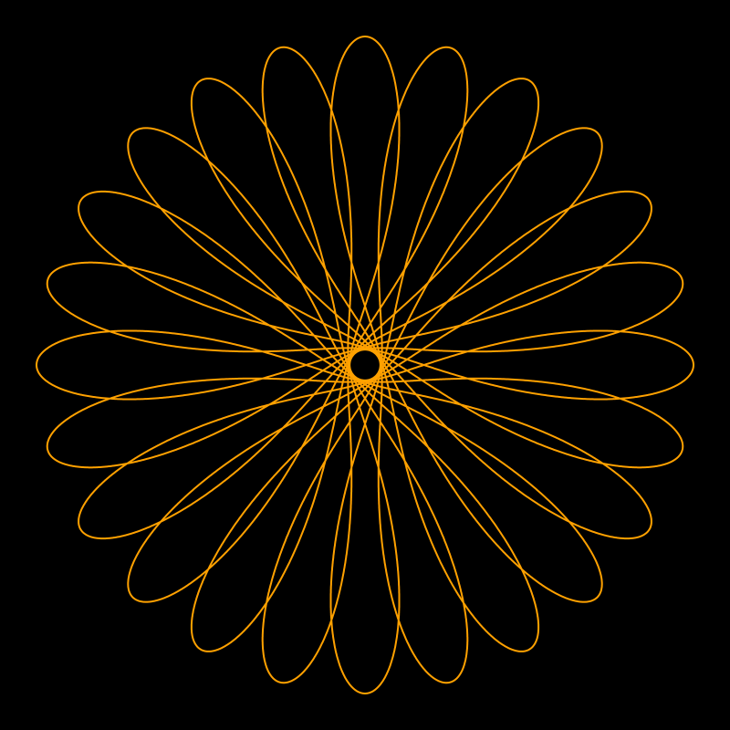</td>
<td valign="top">

```
# Three arms with speeds 7, -17 and 31. All three are 7 more than a multiple
# of 24, so the curve has 24-fold symmetry, and since they share no common
# factor it only closes after a full turn.
background black

layer {
  pen orange 2
  classic {
    ring 80
    arm 50 speed 7
    arm 35 speed -17
    arm 20 speed 31
  }
}
```

</td>
</tr>
</table>

[`examples/mandala-24-fold.spiro`](examples/mandala-24-fold.spiro) · [back to contents](#contents)

## coding-train

The Coding Train's fractal spirograph.

<table>
<tr>
<td width="320" valign="top">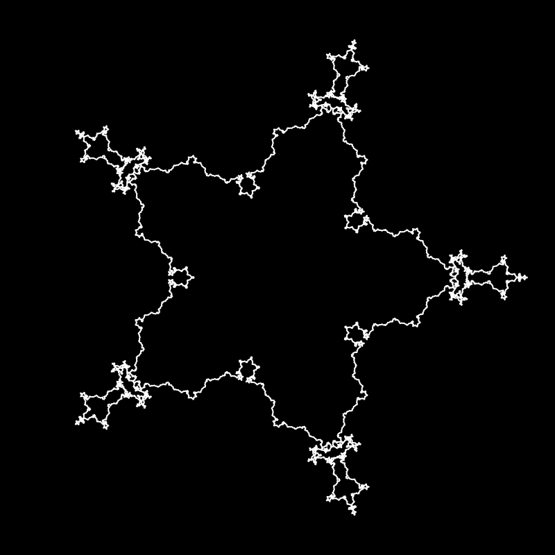</td>
<td valign="top">

```
# The Coding Train's fractal spirograph (Coding Challenge #61).
#
# Each arm is a third as long as the one before it, and spins 4 times as
# fast in the opposite direction. The speeds are 1, -4, 16, -64, ... and
# every one of them is 1 more than a multiple of 5, which is why the curve
# has 5-fold symmetry.
background black

layer {
  pen white 2
  fractal {
    length 60
    speed 1
    length_multiplier 1/3
    speed_multiplier -4
    count 8
  }
}
```

</td>
</tr>
</table>

[`examples/coding-train.spiro`](examples/coding-train.spiro) · [back to contents](#contents)

## fractal-8-fold

Fractal, speed multiplier −7.

<table>
<tr>
<td width="320" valign="top">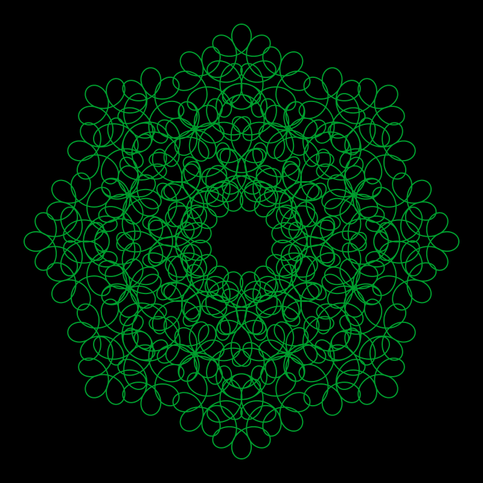</td>
<td valign="top">

```
# A fractal with a speed multiplier of -7 (8-fold symmetry). Each arm is half
# as long as the last, so four arms are enough to fill the screen with lace.
background black

layer {
  pen lime 2
  fractal {
    length 60
    speed 1
    length_multiplier 1/2
    speed_multiplier -7
    count 4
  }
}
```

</td>
</tr>
</table>

[`examples/fractal-8-fold.spiro`](examples/fractal-8-fold.spiro) · [back to contents](#contents)

## fractal-same-direction

Fractal with every arm spinning the same way.

<table>
<tr>
<td width="320" valign="top">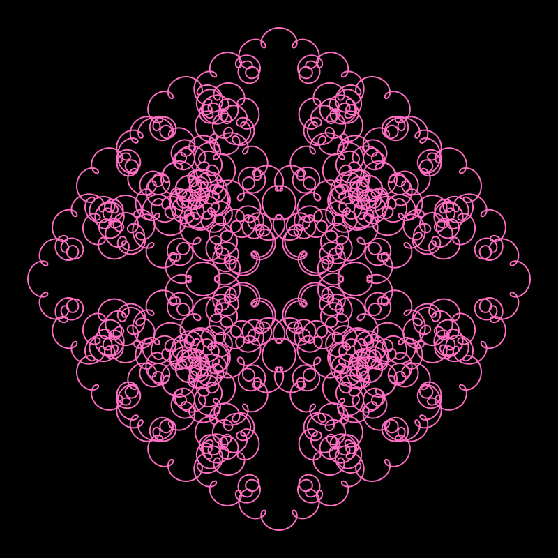</td>
<td valign="top">

```
# A fractal whose arms all spin the same way (a positive multiplier of 5).
# The speeds 1, 5, 25, ... are all 1 more than a multiple of 4, so the curve
# has 4-fold symmetry, with loops that bulge outwards instead of in.
background black

layer {
  pen pink 2
  fractal {
    length 60
    speed 1
    length_multiplier 1/2
    speed_multiplier 5
    count 5
  }
}
```

</td>
</tr>
</table>

[`examples/fractal-same-direction.spiro`](examples/fractal-same-direction.spiro) · [back to contents](#contents)

## string-art

35-tooth wheel in a 96-tooth ring: 96 loops.

<table>
<tr>
<td width="320" valign="top">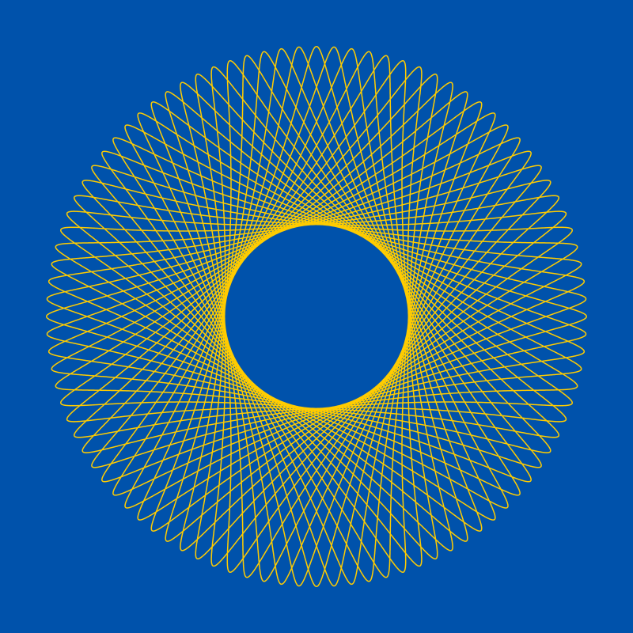</td>
<td valign="top">

```
# A 35-tooth wheel in a 96-tooth ring: 35 and 96 share no factor, so the
# curve makes 96 loops before it closes, and the overlapping lines look
# like string art.
background darkblue

layer {
  pen gold 1.5
  toy ring 96 wheel 35 hole 30
}
```

</td>
</tr>
</table>

[`examples/string-art.spiro`](examples/string-art.spiro) · [back to contents](#contents)

## fractal-4-fold

Fractal, speed multiplier −3.

<table>
<tr>
<td width="320" valign="top">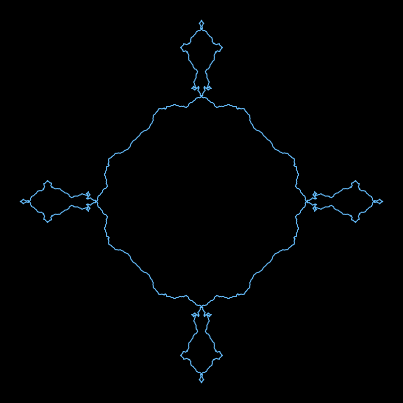</td>
<td valign="top">

```
# The Coding Train fractal with a speed multiplier of -3 instead of -4.
#
# The speeds are 1, -3, 9, -27, ... which are all 1 more than a multiple
# of 4, so the curve has 4-fold symmetry. In general a multiplier of -k
# gives (k + 1)-fold symmetry.
background black

layer {
  pen skyblue 2
  fractal {
    length 60
    speed 1
    length_multiplier 1/3
    speed_multiplier -3
    count 8
  }
}
```

</td>
</tr>
</table>

[`examples/fractal-4-fold.spiro`](examples/fractal-4-fold.spiro) · [back to contents](#contents)

## fractal-6-fold

Fractal, speed multiplier −5.

<table>
<tr>
<td width="320" valign="top">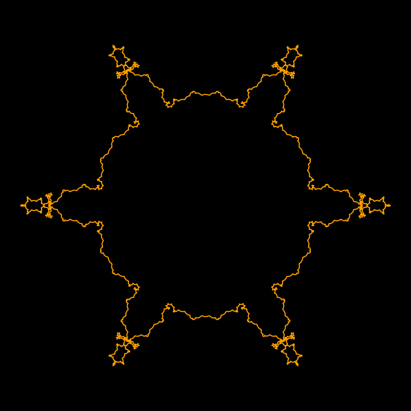</td>
<td valign="top">

```
# The Coding Train fractal with a speed multiplier of -5: speeds 1, -5, 25,
# -125, ... are all 1 more than a multiple of 6, so the curve has 6-fold
# symmetry. The arms shrink to a quarter each time, so the faster arms
# don't swamp the shape.
background black

layer {
  pen orange 2
  fractal {
    length 60
    speed 1
    length_multiplier 1/4
    speed_multiplier -5
    count 6
  }
}
```

</td>
</tr>
</table>

[`examples/fractal-6-fold.spiro`](examples/fractal-6-fold.spiro) · [back to contents](#contents)

## farris-6-fold

Farris's wheels on wheels: speeds 1, 7, −17.

<table>
<tr>
<td width="320" valign="top">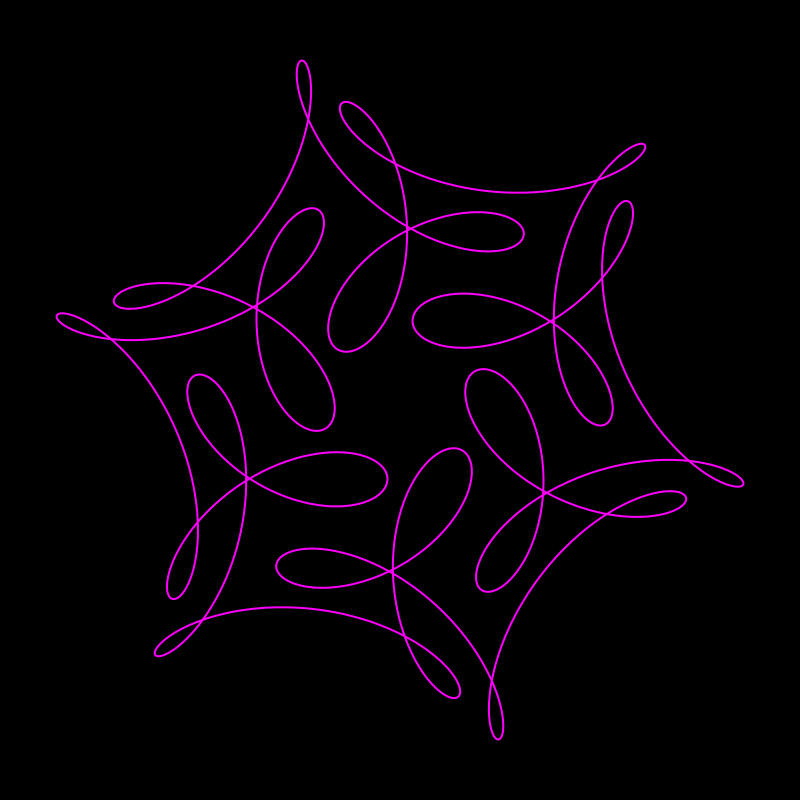</td>
<td valign="top">

```
# Frank Farris, "Wheels on Wheels on Wheels" (1996): three arms with speeds
# 1, 7 and -17. All three speeds are 1 more than a multiple of 6, so the
# curve has 6-fold symmetry. The third arm starts a quarter turn ahead
# (phase pi/2), as in Farris's example.
background black

layer {
  pen magenta 2
  classic {
    ring 80
    arm 60 speed 1
    arm 30 speed 7
    arm 20 speed -17 phase 1.5708
  }
}
```

</td>
</tr>
</table>

[`examples/farris-6-fold.spiro`](examples/farris-6-fold.spiro) · [back to contents](#contents)

## farris-5-fold

Farris-style: speeds 1, 6, −14.

<table>
<tr>
<td width="320" valign="top">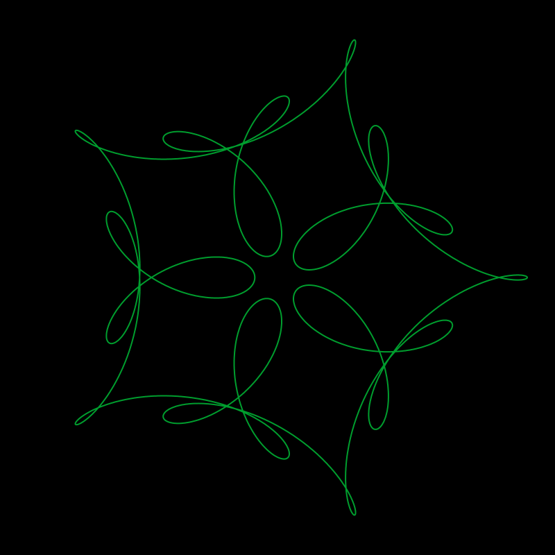</td>
<td valign="top">

```
# Farris-style wheels on wheels with 5-fold symmetry: the speeds 1, 6 and
# -14 are all 1 more than a multiple of 5.
background black

layer {
  pen lime 2
  classic {
    ring 80
    arm 60 speed 1
    arm 30 speed 6
    arm 20 speed -14
  }
}
```

</td>
</tr>
</table>

[`examples/farris-5-fold.spiro`](examples/farris-5-fold.spiro) · [back to contents](#contents)

## rosette

Three toy wheels in one ring.

<table>
<tr>
<td width="320" valign="top">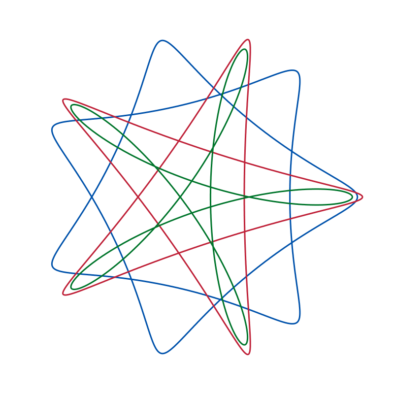</td>
<td valign="top">

```
# Three toy wheels in the same 105-tooth ring, drawn on top of each other,
# like using several wheels and pens on one sheet of paper.
background white

layer {
  pen darkblue 3
  toy ring 105 wheel 30 hole 20
}

layer {
  pen maroon 3
  toy ring 105 wheel 42 hole 35
}

layer {
  pen darkgreen 3
  toy ring 105 wheel 63 hole 50
}
```

</td>
</tr>
</table>

[`examples/rosette.spiro`](examples/rosette.spiro) · [back to contents](#contents)

## cusps

Deltoid, astroid and ellipse.

<table>
<tr>
<td width="320" valign="top">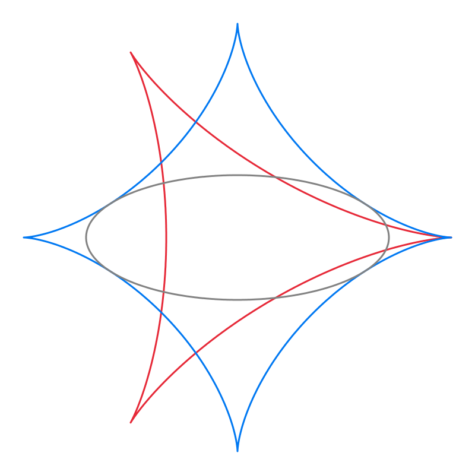</td>
<td valign="top">

```
# When the pen is right on the wheel's rim (hole = wheel), the curve gets
# sharp points, called cusps.
background white

# Deltoid: a wheel a third the size of the ring gives 3 cusps.
layer {
  pen red 3
  toy ring 96 wheel 32 hole 32
}

# Astroid: a wheel a quarter the size of the ring gives 4 cusps.
layer {
  pen blue 3
  toy ring 96 wheel 24 hole 24
}

# A wheel half the size of the ring traces a straight line (the Tusi
# couple), and moving the pen inside the wheel turns it into an ellipse.
layer {
  pen gray 3
  toy ring 96 wheel 48 hole 20
}
```

</td>
</tr>
</table>

[`examples/cusps.spiro`](examples/cusps.spiro) · [back to contents](#contents)

## epicycloids

Cardioid and nephroid.

<table>
<tr>
<td width="320" valign="top">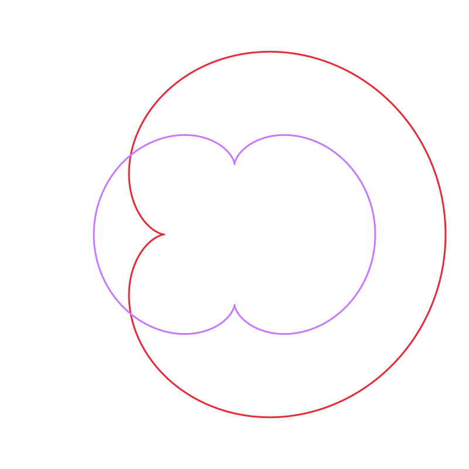</td>
<td valign="top">

```
# Wheels rolling around the outside of a fixed circle of radius 30: the
# first arm is longer than the ring, so the wheel sits outside it.
background white

# Cardioid: a wheel the same size as the fixed circle, pen on its rim.
layer {
  pen red 3
  classic {
    ring 30
    arm 60 speed 1
    arm 30 speed 2
  }
}

# Nephroid: a wheel half the size of the fixed circle, pen on its rim.
layer {
  pen purple 3
  classic {
    ring 30
    arm 45 speed 1
    arm 15 speed 3
  }
}
```

</td>
</tr>
</table>

[`examples/epicycloids.spiro`](examples/epicycloids.spiro) · [back to contents](#contents)

## star

Five-pointed star from two arms.

<table>
<tr>
<td width="320" valign="top">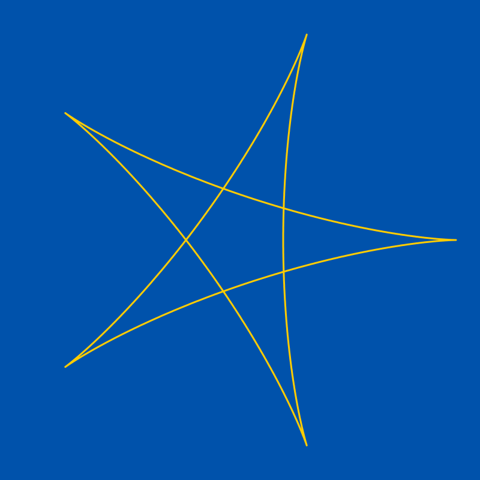</td>
<td valign="top">

```
# Two arms turning in opposite directions at speeds 2 and -3 draw a
# five-pointed star with curved sides.
background darkblue

layer {
  pen gold 3
  classic {
    ring 100
    arm 60 speed 2
    arm 40 speed -3
  }
}
```

</td>
</tr>
</table>

[`examples/star.spiro`](examples/star.spiro) · [back to contents](#contents)

## toy

Two toy wheels in a 96-tooth ring.

<table>
<tr>
<td width="320" valign="top">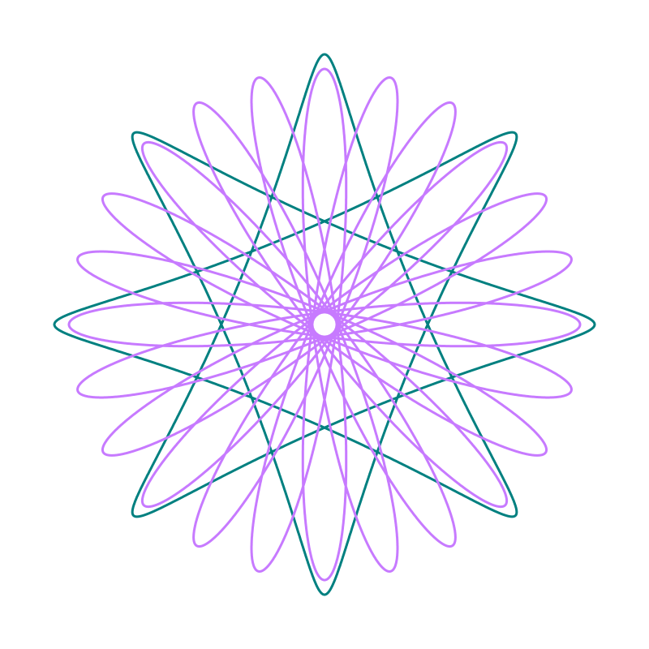</td>
<td valign="top">

```
# A classic toy spirograph: a 36-tooth wheel rolling inside a 96-tooth
# ring, with the pen 28.8 from the wheel's centre.
background white

layer {
  pen x008080 3
  toy ring 96 wheel 36 hole 28.8
}

# A second wheel in the same ring, drawn on top.
layer {
  pen purple 3
  toy ring 96 wheel 52 hole 40
}
```

</td>
</tr>
</table>

[`examples/toy.spiro`](examples/toy.spiro) · [back to contents](#contents)

## fractal

The README's fractal.

<table>
<tr>
<td width="320" valign="top">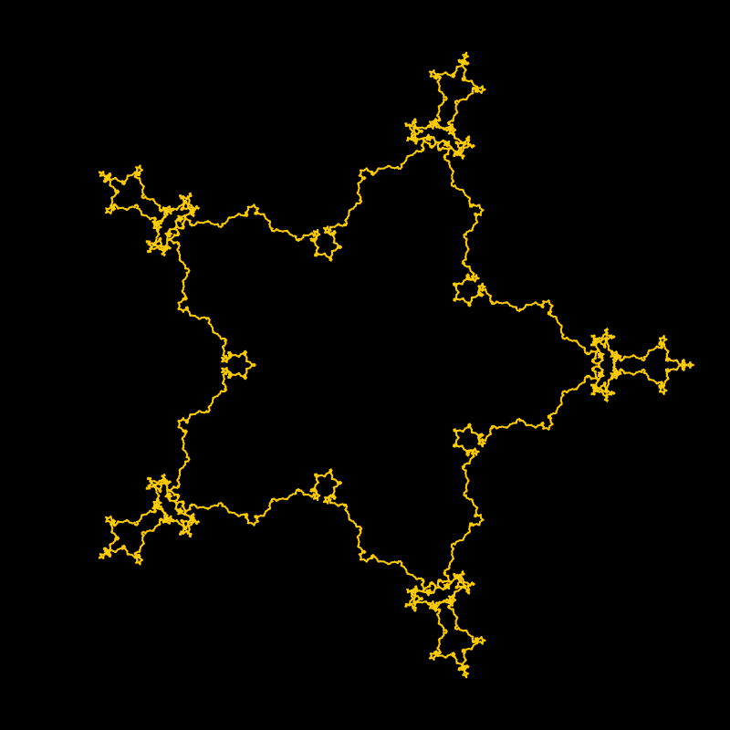</td>
<td valign="top">

```
# A Coding Train style fractal spirograph: each arm is a third as long as
# the one before it, and spins 4 times as fast in the other direction.
background black

layer {
  pen gold 2
  fractal {
    length 60
    speed -3
    length_multiplier 1/3
    speed_multiplier -4
    count 7
  }
}
```

</td>
</tr>
</table>

[`examples/fractal.spiro`](examples/fractal.spiro) · [back to contents](#contents)

## readme

The README example: classic, toy and fractal.

<table>
<tr>
<td width="320" valign="top">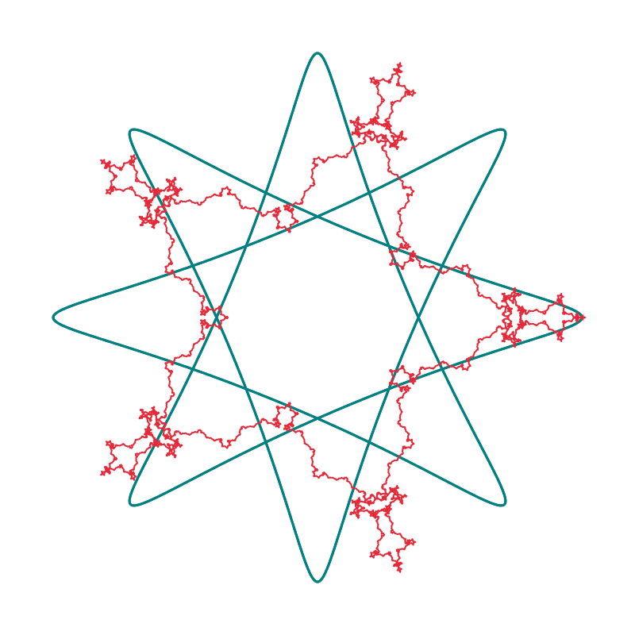</td>
<td valign="top">

```
background white

# The same classic curve, written two ways
layer {
  pen x008080 3               # teal, as a hex color
  classic {
    ring 96
    arm 60 speed 3
    arm 28.8 speed -5
  }
}

layer {
  pen x008080 3
  toy ring 96 wheel 36 hole 28.8
}

# A Coding Train style fractal: 7 arms
layer {
  pen red 2
  fractal {
    length 60                 # the first arm...
    speed -3
    length_multiplier 1/3     # ...each next one a third as long...
    speed_multiplier -4       # ...and 4x faster, reversed
    count 7
  }
}
```

</td>
</tr>
</table>

[`examples/readme.spiro`](examples/readme.spiro) · [back to contents](#contents)
